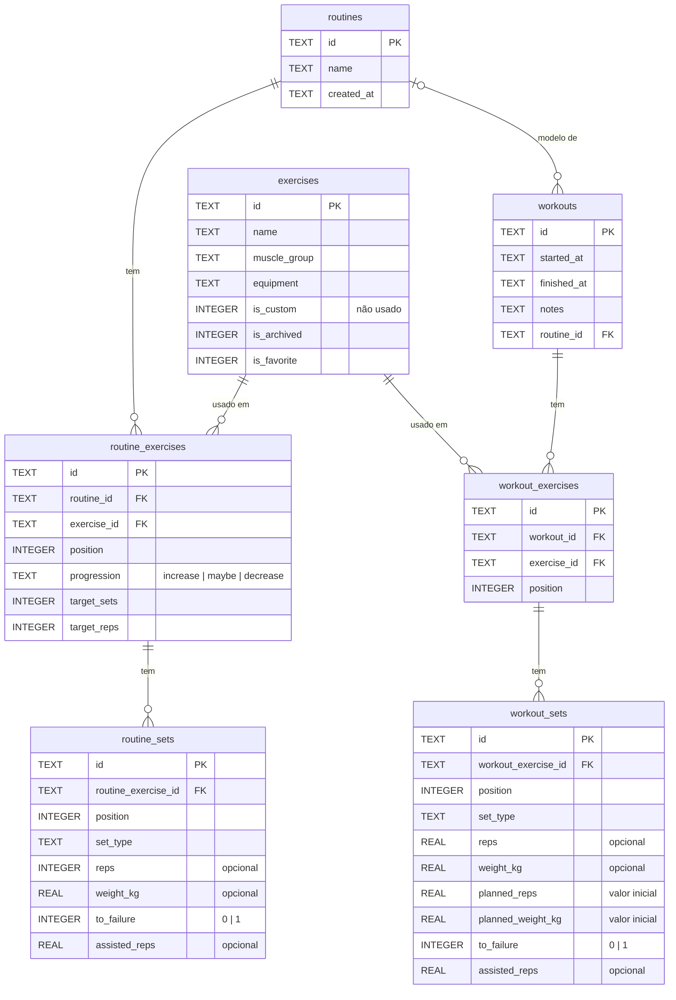
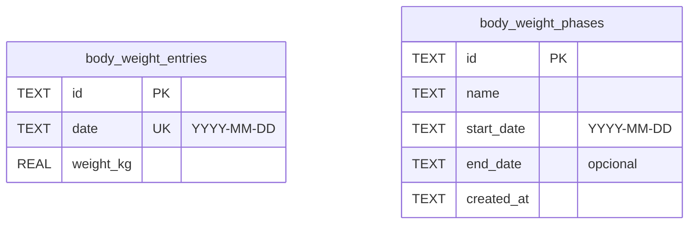
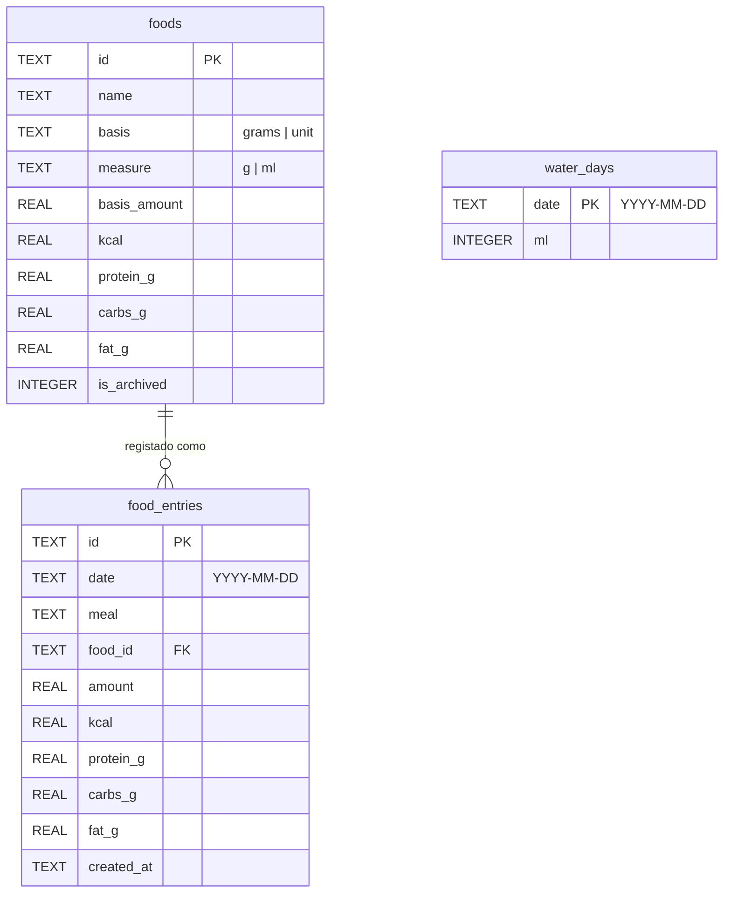
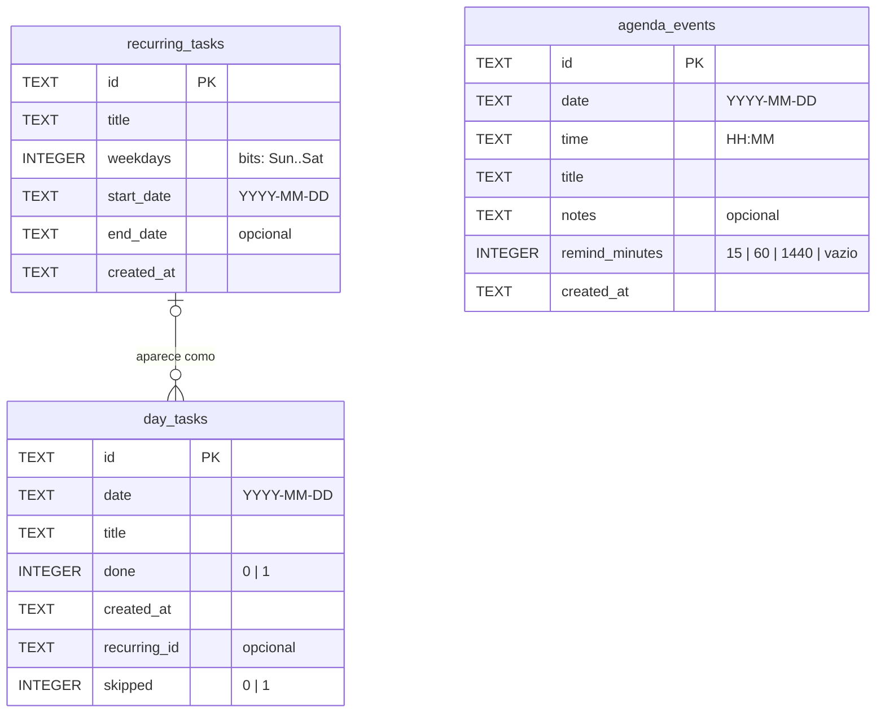

# 🏋️ GymLog

🇵🇹 **Português** · [🇬🇧 English](README.md)
 


 
> ✅ **A app está feita e uso-a todos os dias.** Agora só faço pequenos ajustes.
 
O **GymLog** é uma app pessoal para Android para registar treinos de ginásio, peso corporal e dieta, com uma pequena agenda do dia a dia. Funciona **totalmente offline**: não há servidor nem login, e todos os dados ficam guardados no telemóvel com SQLite.
 
Estou a construí-la para os meus próprios treinos: queria uma app simples e rápida, que funcione mesmo sem rede no ginásio, guarde todo o meu histórico e mostre o meu progresso, sem anúncios nem subscrições.
 
## 📸 Capturas de ecrã
 
<p align="center">
  
  
  
</p>
<p align="center">
  
  
  
</p>
<p align="center">
  
  
  
</p>

Mais capturas no [guia de utilização](docs/user-guide.pt.md).
 
## 🎯 Objetivos
 
- Registar um treino completo depressa, com ou sem internet
- Ver o que levantei da última vez em cada exercício enquanto treino
- Acompanhar o progresso de força de cada exercício (em cada rotina) com histórico e gráfico
- Registar o peso todos os dias e ver a tendência real num gráfico, e acompanhar cada bulk ou cut como uma época
- Registar o que como e ver as kcal, proteína, carbos e gordura do dia (e de cada refeição) face ao meu plano, e a água que bebo
- Ter as tarefas do dia e as marcações importantes num só sítio, com um aviso antes de cada marcação
- Nunca perder dados: exportar e importar backups facilmente
- Não começar do zero: exercícios e alimentos de exemplo opcionais

## 📋 Funcionalidades
 
| Funcionalidade | Descrição |
|---------|-------------|
| Biblioteca de exercícios | Os meus exercícios agrupados por grupo muscular, com pesquisa e filtro; abre-se pelo botão no canto superior direito do separador Treino |
| Gerir exercícios | Criar, editar e arquivar os meus próprios exercícios (a lista começa vazia) |
| Exercícios favoritos | Marcar exercícios com estrela para aparecerem primeiro nas listas |
| Rotinas | Uma por cada treino da semana (ex.: Push, Pull, Pernas): exercícios por ordem e séries planeadas (W/F/T/B, peso, reps). A rotina feita mais recentemente aparece primeiro, com o dia em que foi feita pela última vez |
| Nota para a próxima semana | Por exercício: verde "aumentar carga", amarelo "em princípio aumentar" ou vermelho "diminuir carga" (sem nota mantém o peso) |
| Registo do treino | Começar a partir de uma rotina, já preenchido com os últimos pesos; mudar peso e reps (meias reps permitidas), adicionar ou tirar séries, adicionar exercícios (também entram na rotina). Terminar copia o que foi feito para a rotina |
| Back-off até à falha | Uma chama em cada back-off (na rotina e no treino) marca-o como feito até à falha em vez de um número de reps ("85 kg × falha") |
| Reps com ajuda | Um ícone de mão no fim de cada top set regista as reps feitas com ajuda ("100 kg × 6 +2"). Tal como os pesos, passam para a rotina e o treino seguinte começa com elas; nunca contam como progresso |
| Cronómetro do treino | O cabeçalho do treino mostra há quanto tempo estás a treinar (⏱ 42:13) |
| Resumo do treino | Depois de terminar: duração, exercícios, séries, volume, progressões e os top sets e back-offs feitos ("12 kg × 5 +1 com ajuda") |
| Histórico do exercício | Ícone em cada exercício: popup com as progressões (▲ verde) e regressões (▼ vermelho), top set antes → depois, por rotina |
| Progresso do exercício | Gráfico do peso do top set ao longo do tempo, por exercício e rotina: só os treinos em que o top set subiu ou desceu |
| Registo do peso | Um registo por dia (hoje ou dias passados); guardar de novo no mesmo dia atualiza-o |
| Gráfico do peso | Valores diários e uma linha no peso objetivo; o resumo mostra a média de 7 dias e quanto falta para o objetivo |
| Épocas de peso | Períodos com nome, como um bulk ou um cut, com data de início e de fim (opcional); cada uma tem o seu gráfico, variação total, ritmo semanal (kg e % do peso corporal), peso mais baixo/mais alto e quanto já passou |
| Registo da dieta | Dia a dia (‹ › para mudar de dia): um anel com as kcal restantes e um anel por macro (vermelho quando passa); 6 refeições (Pequeno-almoço … Ceia), cada uma com o seu ícone, kcal comidas / planeadas (ex.: 420/400) e uma barra. Tocar numa refeição abre-a: os seus alimentos (toca num para mudar a quantidade), um donut com a parte das kcal que vem dos carbos, proteína e gordura, e **Adicionar alimento** (é sugerida a quantidade da última vez, ex.: 2 tostas) |
| Objetivos da dieta | Kcal por dia (obrigatório), proteína / carbos / gordura (opcionais) e mais ou menos quantas kcal planeio para cada refeição (opcional) |
| Água | Uma garrafa que enche à medida que bebo: +250 / +500 ml, qualquer outra quantidade em ml ou L, − para tirar um copo, tocar no total para o corrigir e uma meta diária; guardada por dia |
| Exportar para Excel | Definições → Exportar peso e dieta: mostra de quando a quando há registos, deixa escolher tudo, a semana passada, os últimos 30 dias ou quaisquer datas, resume-as (dias, pesagens, médias por dia) e exporta um ficheiro .xlsx com o peso e as kcal, proteína, carbos e gordura de cada dia (ex.: para um nutricionista). Nada a mais é guardado |
| Biblioteca de alimentos | Os meus alimentos com kcal e macros por X gramas, por X ml ou por unidade, com pesquisa; editar um alimento nunca muda os dias já registados |
| Agenda: dia a dia | As tarefas do dia com checkbox (‹ › para mudar de dia): adicionar, marcar, mudar o nome, passar para o dia seguinte ou apagar |
| Tarefas que se repetem | Tarefas que voltam em dias escolhidos de todas as semanas (ex.: às terças e quintas, todos os sábados, todos os dias): aparecem sozinhas nesses dias; saltar um dia, mudar os dias ou deixar de repetir (os dias feitos ficam) |
| Agenda: eventos | Consultas e outras coisas importantes com dia, hora, notas e um aviso opcional 15 min, 1 hora ou 1 dia antes. Os avisos são notificações locais: funcionam com a app fechada e sem internet |
| Limpeza automática | Ao abrir a app: são apagadas as tarefas feitas há mais de 30 dias, as tarefas por fazer há mais de 90 dias, os eventos passados há mais de 12 meses e as repetições paradas há mais de 90 dias. Treinos, peso e dieta nunca são apagados |
| Backup | Exportar para um ficheiro JSON e voltar a importá-lo, escolhendo as partes: treinos, peso, dieta e/ou agenda |
| Exercícios e alimentos de exemplo | Opcional, nas Definições: adiciona uma lista de exercícios e alimentos (só os que faltam, pelo nome) depois de mostrar o que já tens; nada teu é mudado nem apagado |
| Modo escuro | Definições → Aparência: automático (segue o telemóvel), claro ou escuro |
| Aspeto | Cabeçalho arredondado com o ícone do separador, cor de destaque roxa, botões que reagem ao toque e pequenas animações (garrafa, anéis, resumo); com a opção "remover animações" do telemóvel ligada, ficam mais discretas |
 
## 🛠️ Tecnologias
 
| Para quê | Tecnologia |
|---------|------------|
| Framework | React Native + Expo |
| Linguagem | TypeScript (strict) |
| Navegação | Expo Router |
| Base de dados local | expo-sqlite |
| IDs | expo-crypto (UUIDs) |
| Gráficos e desenhos | react-native-gifted-charts, react-native-svg |
| Animações | react-native-reanimated |
| Avisos | expo-notifications (notificações locais) |
| Seletores de data e hora | @expo/ui |
| Ficheiros de backup | expo-file-system, expo-sharing, expo-document-picker |
| Build | EAS Build (APK para Android) |
| Testes | Jest |
 
## 🏗️ Estrutura do projeto
 
```
GymLog/
├── src/
│   ├── app/                → ecrãs (Expo Router)
│   │   ├── (tabs)/         → Treino, Dieta, Peso, Agenda, Definições
│   │   ├── exercises.tsx   → lista de exercícios (aberta a partir do Treino)
│   │   ├── exercise/       → detalhes do exercício, criar/editar, gráfico do progresso
│   │   ├── agenda/         → criar/editar um evento da agenda, tarefas que se repetem
│   │   ├── phases.tsx      → lista das épocas de peso
│   │   ├── phase/          → uma época (gráfico e números), criar/editar
│   │   ├── diet/           → uma refeição, adicionar alimento a uma refeição, os meus alimentos, objetivos
│   │   ├── routine/        → rotina, mudar nome, adicionar exercícios, séries planeadas
│   │   └── workout/        → resumo do treino
│   ├── components/         → componentes de interface reutilizáveis
│   ├── data/               → exercícios e alimentos de exemplo (só adicionados a pedido)
│   ├── hooks/              → lógica dos ecrãs (carregar dados, ações)
│   ├── db/
│   │   ├── schema.ts       → lista das tabelas (ordem usada nos backups)
│   │   ├── migrations.ts   → definição das tabelas e migrations (v1 a v20)
│   │   ├── repositories/   → funções de acesso aos dados (um ficheiro por entidade, + testes)
│   │   └── __tests__/      → testes das migrations
│   ├── lib/                → lógica pura: pesquisa, nomes, séries, progresso, datas, peso, dieta, agenda, backup (+ testes)
│   ├── notifications/      → avisos da agenda (notificações locais)
│   ├── theme/              → cores do modo claro e escuro, tamanhos (espaços, texto, cantos, movimento), provider do tema
│   ├── test-utils/         → SQLite em memória para os testes dos repositórios
│   └── types/              → tipos TypeScript partilhados
├── assets/
├── app.json
├── eas.json
└── README.md
```
 
## 🗃️ Modelo de dados
 
| Tabela | Campos principais |
|-------|-------------|
| exercises | id, name, muscle_group, equipment, is_custom (não usado), is_archived, is_favorite |
| routines | id, name, created_at |
| routine_exercises | id, routine_id, exercise_id, position, progression (increase, maybe, decrease ou vazio), target_sets (não usado), target_reps (não usado) |
| routine_sets | id, routine_exercise_id, position, set_type (warmup, feeder, top, backoff), reps (opcional), weight_kg (opcional), to_failure (back-off até à falha, então sem reps), assisted_reps (top sets: reps feitas com ajuda da última vez) |
| workouts | id, started_at, finished_at, notes, routine_id (opcional) |
| workout_exercises | id, workout_id, exercise_id, position |
| workout_sets | id, workout_exercise_id, position, set_type (warmup, feeder, top, backoff), reps (só top/backoff), weight_kg (vazio até ser preenchido), planned_reps e planned_weight_kg (valores com que a série começou), to_failure (back-off até à falha), assisted_reps (reps feitas com ajuda, só top sets) |
| body_weight_entries | id, date (única), weight_kg |
| body_weight_phases | id, name, start_date, end_date (vazio enquanto decorre), created_at |
| app_settings | key, value (peso objetivo, tema, objetivos da dieta com as kcal planeadas por refeição, meta de água) |
| foods | id, name, basis (grams ou unit), measure (g ou ml), basis_amount, kcal, protein_g, carbs_g, fat_g, is_archived |
| food_entries | id, date, meal, food_id, amount, kcal, protein_g, carbs_g, fat_g (guardados ao registar), created_at |
| diet_days | date, training_kcal (não usado, mantido para as migrations antigas ficarem intactas) |
| water_days | date (uma linha por dia), ml |
| recurring_tasks | id, title, weekdays (bits, de domingo a sábado), start_date, end_date (vazio enquanto se repete), created_at |
| day_tasks | id, date, title, done, created_at, recurring_id (a repetição de onde vem, ou vazio), skipped (tarefa repetida saltada nesse dia) |
| agenda_events | id, date, time, title, notes (opcional), remind_minutes (15, 60, 1440 ou vazio), created_at |

### Treinos e exercícios



- `workouts.routine_id` é opcional: um treino pode começar sem rotina.
- `workout_sets.set_type` e `routine_sets.set_type` são um de `warmup`, `feeder`, `top` ou `backoff`.
- Uma rotina guarda, para cada exercício, as séries planeadas: tipo mais reps e peso opcionais (ex.: W 15×40, F 3×70, T 6×100, B 8×85). Os back-offs podem ser planeados até à falha e os top sets guardam as reps feitas com ajuda. Os treinos que começam a partir dela vêm preenchidos com estes valores; quando um treino termina, os valores feitos são copiados de volta para a rotina (a estrutura não muda). Cancelar um treino não muda nada.
- Apagar um treino apaga os seus exercícios e séries. Um exercício já usado num treino não pode ser apagado, só arquivado.

### Peso corporal

Independente das tabelas dos treinos: um registo por dia. As épocas só guardam as datas: os seus registos são os que estão entre essas datas.



### Dieta

Os alimentos são os meus; cada registo guarda uma cópia dos valores calculados para a quantidade comida. A água é um total por dia.



### Agenda

Independente de tudo o resto. Uma tarefa que se repete ganha a sua linha em `day_tasks` em cada um dos seus dias quando esse dia é aberto. Os avisos não são guardados: são marcados no telemóvel a partir de cada evento (e refeitos quando a app abre ou quando se importa um backup).


 
## 🗺️ Roadmap
 
- [X] Fase 0: Configuração do projeto (Expo + TypeScript + Expo Router)
- [X] Fase 1: Esquema da base de dados, migrations e exercícios incluídos
- [X] Fase 2: Biblioteca de exercícios e exercícios próprios
- [X] Fase 3: Rotinas, registo de treinos, histórico de progresso e gráficos → **MVP**
- [X] Fase 4: Registo e gráfico do peso → **MVP**
- [X] Fase 5: Exportar / importar backups → **MVP**
- [X] Fase 6: Primeiro APK instalado no meu telemóvel
- [X] Extras: peso objetivo, modo escuro, ícone novo, progresso por rotina e registo da dieta
- [X] Extras: backups por partes, nota amarela, back-offs até à falha, reps com ajuda e cronómetro do treino
- [X] Extras: épocas de peso (bulk/cut), exercícios e alimentos de exemplo, última quantidade de cada alimento, mudar uma quantidade registada, kcal planeadas por refeição
- [X] Extras: aspeto novo, ecrã da refeição, água, separador Agenda (tarefas, tarefas que se repetem e eventos com avisos) e limpeza automática de tarefas e eventos antigos
- [X] Extras: exportação do peso e da dieta para Excel, nota "diminuir", gráfico de progresso mais limpo e histórico mais rápido
- [ ] Em curso: pequenos ajustes do uso diário

## 📖 Como correr (desenvolvimento)
 
```bash
npm install
npx expo start
```

Correr os testes:

```bash
npm test
```
 
Abre com uma development build ou com o Expo Go no telemóvel.
 
## 📦 Build e instalação no Android
 
```bash
npx eas-cli@latest login
npx eas-cli@latest build -p android --profile preview
```
 
O perfil `preview` do `eas.json` está configurado para gerar um **APK**. Descarrega-o pelo link no fim da build e instala-o no telemóvel. Instalar um APK novo por cima do antigo mantém os dados.

Os avisos da agenda precisam de um APK feito depois de o `expo-notifications` ter sido adicionado: confirma-os no APK, não no Expo Go. Da primeira vez que um evento tem aviso, o Android pede permissão para mostrar notificações.
 
## 💾 Backups
 
Os dados existem só no telemóvel. Usa **Definições → Exportar backup** regularmente e guarda o ficheiro no Google Drive ou envia-o por email. **Importar backup** restaura tudo num telemóvel novo ou depois de reinstalar. Os dois deixam escolher as partes (treinos, peso, dieta, agenda); importar uma parte substitui só essa parte. Um backup feito por uma versão antiga deixa como está no telemóvel o que ainda não podia ter (ex.: épocas, água ou agenda).
 
## 🎁 Exercícios e alimentos de exemplo

A app começa vazia. A começar do zero? **Definições → Exemplos para começar → Adicionar exemplos** adiciona uma lista de exercícios e alimentos de exemplo (incluída na app, sem dados pessoais). Antes de adicionar, mostra o que já tens com o mesmo nome: isso fica exatamente como está, e nada é apagado. Também podes saltar este passo e criar os teus.

## 📘 Guia de utilização
 
É a primeira vez que usas a app? O **[guia de utilização](docs/user-guide.pt.md)** explica como tudo funciona, passo a passo: exercícios, rotinas, registar um treino, progresso, peso e épocas, dieta e água, a agenda e os backups.
 
## 📄 Licença
 
Este projeto está licenciado sob a licença MIT. Vê o ficheiro [LICENSE](LICENSE) para mais detalhes.
