# 📘 GymLog user guide

🇬🇧 **English** · [🇵🇹 Português](user-guide.pt.md)

This guide explains how to use GymLog, step by step. The app works **offline** and keeps everything on your phone.

The app is in Portuguese, so buttons and labels are written here **exactly as they appear on screen**, with the English meaning in parentheses.

[← Back to the README](../README.md)

## Contents

1. [The idea](#1-the-idea)
2. [First steps: create your exercises](#2-first-steps-create-your-exercises)
3. [Create your routines](#3-create-your-routines)
4. [Working out](#4-working-out)
5. [Tracking progress](#5-tracking-progress)
6. [Body weight](#6-body-weight)
7. [Diet](#7-diet)
8. [Agenda](#8-agenda)
9. [Backup: never lose your data](#9-backup-never-lose-your-data)
10. [Light or dark mode](#10-light-or-dark-mode)
11. [Installing and updating the app](#11-installing-and-updating-the-app)
12. [FAQ](#12-faq)

---

## 1. The idea

GymLog is built around one simple idea: **your workouts are always the same, only the weights change**.

1. You create your exercises and your **routines** (e.g. Push, Pull, Legs) **once**, already with their sets and weights.
2. On workout day you tap **▶** (start) and the workout opens **already filled in** with last time's weights.
3. You change only what went up and tap **Terminar** (Finish). The new weights are saved into the routine for next time.

The app has 5 tabs at the bottom:

| Tab | What it is for |
|-----|----------------|
| 🏋️ **Treino** (Workout) | Your routines and the workout in progress. The 📋 button at the top right opens your exercise list |
| 🥗 **Dieta** (Diet) | What you eat and drink each day: kcal, protein, carbs, fat and water |
| ⚖️ **Peso** (Weight) | Your body weight and its chart |
| 📅 **Agenda** | The day's tasks and your important appointments, with reminders |
| ⚙️ **Definições** (Settings) | Backup (export and import), light/dark mode and examples |

At the top of each tab there is a rounded bar with the tab's icon and name. In the other screens, the round button on the left goes back (**←**), or closes a form (**✕**).

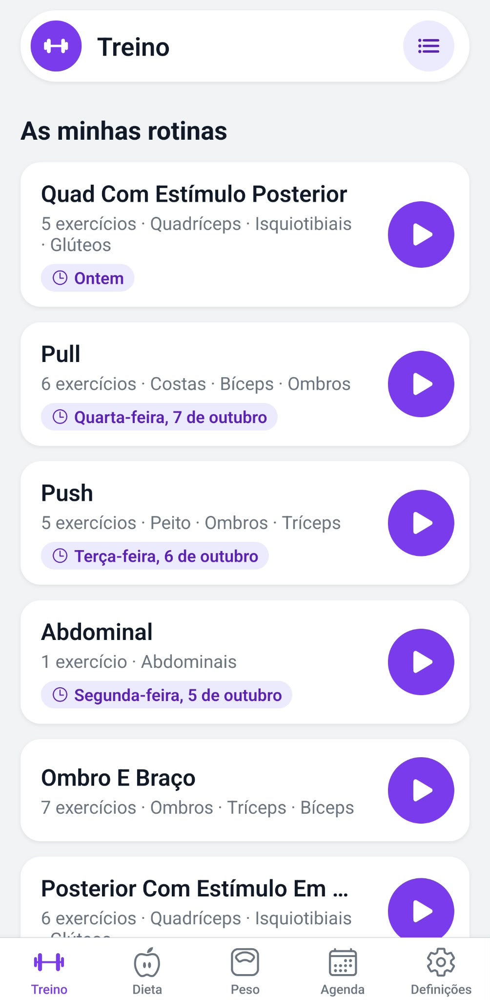

---

## 2. First steps: create your exercises

The exercise list starts **empty**: you create the exercises you actually do. (Want a head start? See [9.3 Example exercises and foods](#93-example-exercises-and-foods).)

1. In the **Treino** (Workout) tab, tap the 📋 button at the top right to open **Exercícios** (Exercises).
2. Tap the round **+** button in the bottom-right corner.
3. Type the **Nome** (name), e.g. "Supino Plano com Barra", pick the **Grupo muscular** (muscle group) and, optionally, the **Equipamento** (equipment).
4. Tap **Criar exercício** (Create exercise).

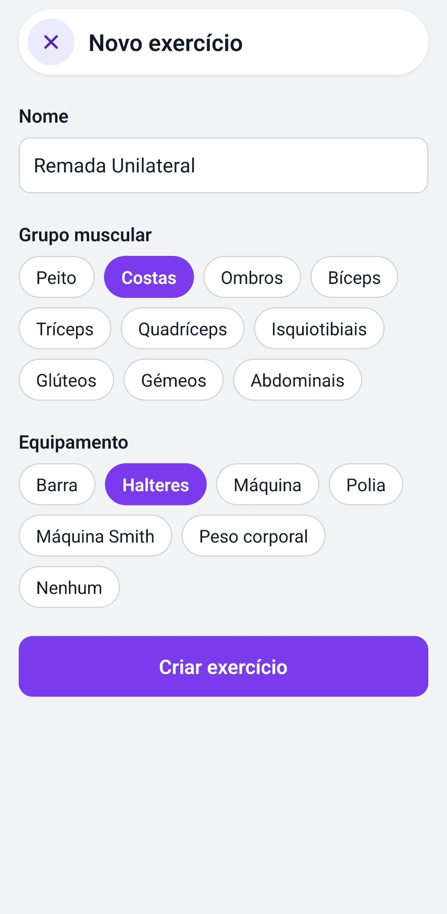

**In the exercise list you can:**
- **Search** by name. Accents don't matter: "biceps" finds "Bíceps".
- **Filter** by muscle group with the buttons at the top.
- Tap the **⭐** to mark an exercise as a **favorite**. Favorites are listed first, also when you pick exercises for a routine.
- Tap an exercise to see its details, **Editar** (edit) it, **Ver progresso** (see progress) or **Apagar** (delete) it.

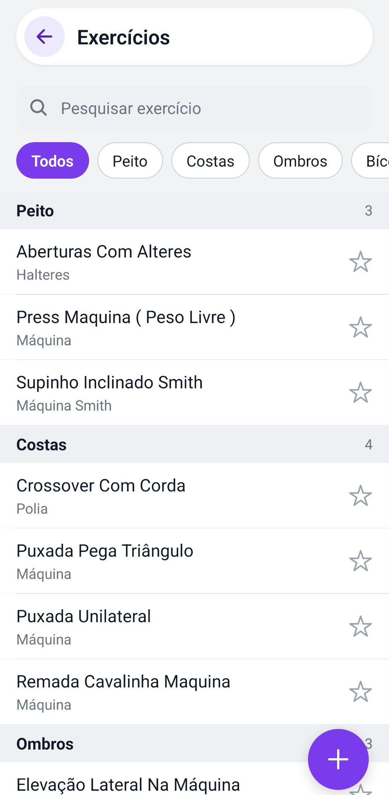

> ℹ️ If you delete an exercise you have already used in a workout, it is **archived** instead: it no longer shows in lists, but your history is kept.

---

## 3. Create your routines

A **routine** is a workout you repeat every week (e.g. "Push" = chest, shoulders and triceps).

### 3.1 Create the routine and pick its exercises

1. In the **Treino** (Workout) tab, tap **+ Nova rotina** (New routine) and give it a name (e.g. "Push").
2. Tap **+ Adicionar exercícios** (Add exercises).
3. Pick the exercises (you can pick several at once and filter by several muscle groups) and tap **Adicionar** (Add).
4. Use the **▲ ▼** arrows to put the exercises in the order you do them. The **✕** removes an exercise from the routine.

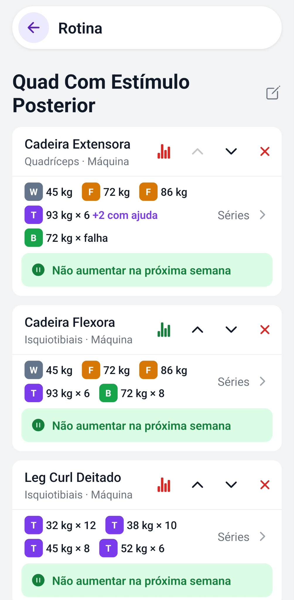

### 3.2 The sets of each exercise

Each exercise has a set structure. Each set has a type:

| Letter | Type | What it is for | Reps? |
|:------:|------|----------------|:-----:|
| **W** | Warm-up (*Aquecimento*) | Light weight, 12–15 reps | ❌ weight only |
| **F** | Feeder | Ramp-up sets, 2–3 reps | ❌ weight only |
| **T** | Top set | Your heaviest set: the one that measures your strength | ✅ weight × reps |
| **B** | Back-off | A lighter set after the top set | ✅ weight × reps, or to failure 🔥 |

Every new exercise starts with **W · F · F · T · B**. To change it:

1. In the routine, tap the row of coloured letters under an exercise (**Séries**, sets).
2. For each set, choose the **type** (W/F/T/B), type the **kg** and, for T and B, the **reps**. A back-off you always take **to failure**? Tap the 🔥 **flame** at the end of it: the reps field becomes **FALHA** (failure). Tap the flame (or FALHA) again to go back to a number.
3. **+ Adicionar série** (Add set) copies the last set (handy for a second top set). The 🗑 deletes a set.
4. Tap **Guardar** (Save).

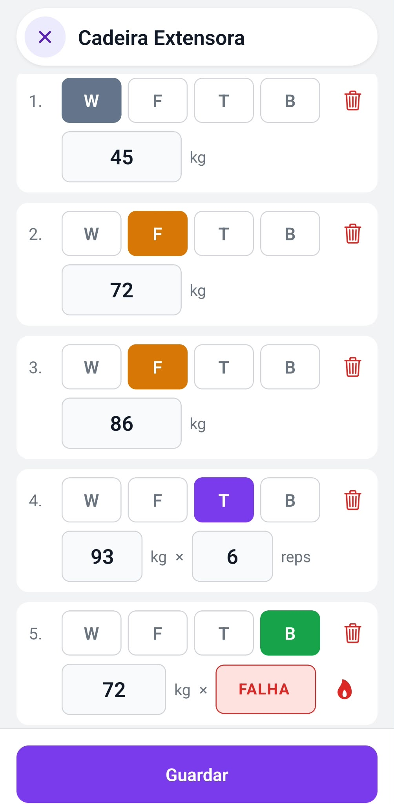

> 💡 Use a **comma** for decimals: `102,5` kg. You can also log **half reps**: `4,5`.

---

## 4. Working out

### 4.1 Start

In the **Treino** (Workout) tab, tap the round purple **▶** button on the day's routine. The routine you did most recently is always at the top of the list, and each routine shows when you last did it (e.g. **Ontem**, yesterday). The workout opens **already filled in** with the routine's weights, which are the ones from the last time you did it.

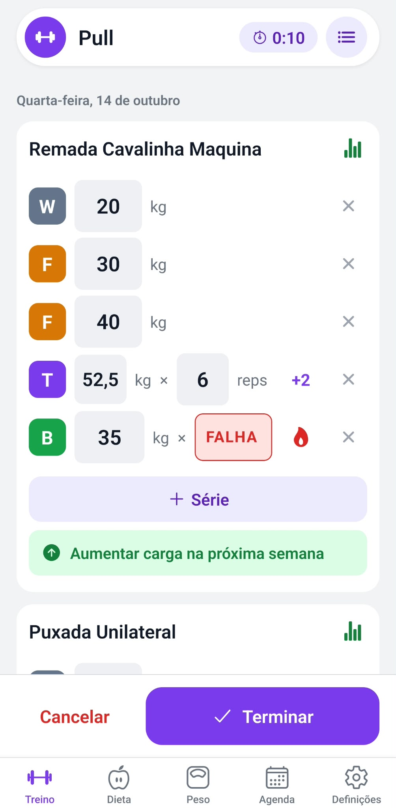

### 4.2 During the workout

- The header at the top shows the routine's name and the ⏱ **timer**: how long you have been training.
- **Change the kg and reps** right in the fields (the field you are typing in has a purple border). Everything is **saved automatically** as you type: if the app closes, nothing is lost.
- **Tap the letter** of a set (W/F/T/B) to change its type.
- **+ Série** (+ Set) adds a set equal to the last one; the **✕** deletes a set.
- You only need to change what is **different** from last time.
- **Back-off to failure**: tap the 🔥 **flame** at the end of a back-off if you went to failure, or type the reps you did instead.
- **Reps with help**: did a spotter help you? Tap the ✋ **hand** at the end of the top set and type how many (e.g. 2). The set then reads **100 kg × 6 +2**; tap the **+2** to change it or **Tirar** (remove) it. Reps with help never count for progress.
- Doing something extra today? Tap **+ Adicionar exercícios** (Add exercises) at the end of the workout. The exercises are also added to the routine, so they are there next time (remove them from the routine if it was a one-off).

### 4.3 The note for next week

At the bottom of each exercise there is a note to remind you what to do next time:

- 🟢 **"Aumentar carga na próxima semana"** (increase the weight next week): time to go up.
- 🟡 **"Em princípio aumentar na próxima semana"** (probably increase next week): go up if you feel good that day.
- 🔴 **"Diminuir carga na próxima semana"** (decrease the weight next week): go down.

Keeping the same weight needs no note: just leave it without one (or remove it).

Tap **+ Nota para a próxima semana** (note for next week), or the note itself: a popup opens to pick one of the three, or **Tirar nota** (remove the note). The note is stored in the routine and shows up in the next workout.

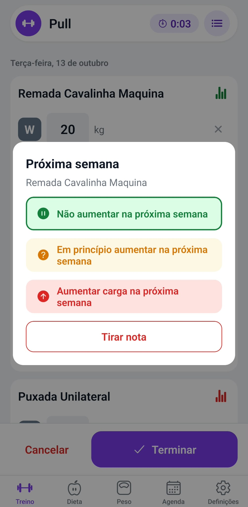

### 4.4 Finish or cancel

- **✓ Terminar** (Finish): the workout is saved and **what you did is copied into the routine**: weights, reps, failure 🔥 and reps with help ✋ (the routine shows e.g. **100 kg × 6 +2 com ajuda**). Next time the workout starts with them; if you do it without help that day, just remove the **+2**. A **Resumo** (summary) shows how long the workout took, the number of exercises and sets, the total volume, your progressions (with a green ↑ badge when you went up) and, under **Séries**, the top sets and back-offs you did (e.g. **12 kg × 5 +1 com ajuda**). The exercise history (the chart icon) also shows the reps done with help.
- If you changed the sets of an exercise during the workout (added or removed a set, or changed its type, e.g. a back-off into a top set), the routine keeps its sets. The summary then shows a **Séries alteradas** (Changed sets) card with those exercises; tap **Guardar estas séries na rotina** (Keep these sets in the routine) on each one you want to keep as it was today.
- **Cancelar** (Cancel): the workout is deleted and **nothing changes** in the routine.

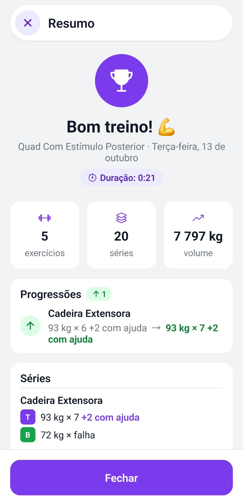 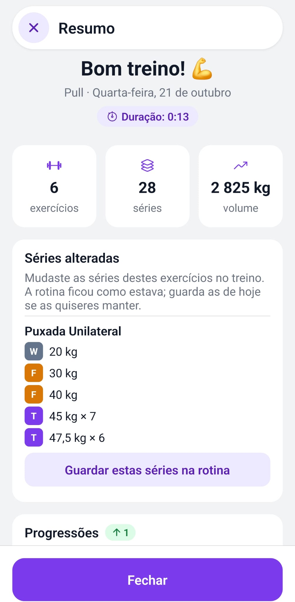

---

## 5. Tracking progress

### 5.1 The 📊 icon on each exercise

Next to each exercise name (in the routine and during the workout) there is an icon:

- 🟢 **Green**: the exercise already has progressions or regressions.
- 🔴 **Red**: it has none yet.

Tap it to see that exercise's history (reps with help are shown too, e.g. `100 kg × 6 +1 com ajuda`):

- ▲ **green**: you went up (e.g. `100 kg × 6 → 102,5 kg × 5`)
- ▼ **red**: you went down

The **Gráfico** (chart) button opens a chart of the top set weight over time. It shows the first workout and then only the workouts where the top set went up or down; workouts with the same top set as before are left out. If your first workout already went up or down, the chart starts at **Início** (start): the values the routine had.

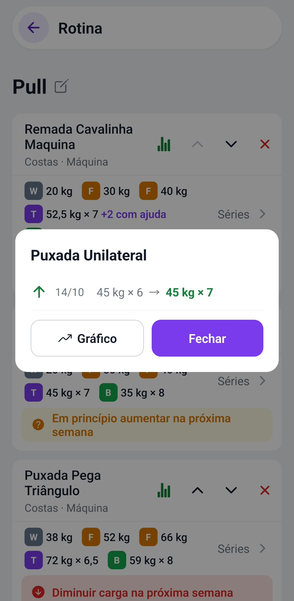

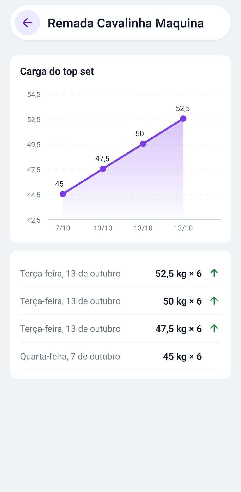

### 5.2 How it is worked out

- Only the **top set** counts (the heaviest one, if you do two). Exercises without a top set use their heaviest set.
- **Progression**: more weight, **or** the same weight with more reps.
- **Regression**: less weight, or the same weight with fewer reps.
- The comparison is with the **last time** you did the exercise **in the same routine**. An exercise done in two routines (e.g. crunches at the end of Push, when you are more tired) has a separate history and chart in each. On the first workout of a routine, it is compared with the weights the workout started with.
- From an exercise's details (**Ver progresso**), buttons at the top choose which routine's chart to show.
- Workouts where **nothing changed** don't appear in the history.

---

## 6. Body weight

1. Open the **Peso** (Weight) tab.
2. Type your weight (e.g. `78,4`) and tap **Guardar** (Save). If you already logged today, the button says **Atualizar** (Update): there is only one entry per day.
3. Forgot a day? Use the **‹ ›** arrows to go to that day and log it.

Below you see:
- Your **latest weight**, the **average of the last 7 days** and how much that average changed in a week.
- The **chart**: the **purple** line (with a soft shade below it) is each day's weight and the dashed **orange** line is your **goal**.

**Goal**: tap **Objetivo** (Goal) to set your target weight (e.g. `75`). The summary then shows how much is left: *Faltam perder 3,4 kg* (3.4 kg left to lose) or *Faltam ganhar…* (… left to gain).

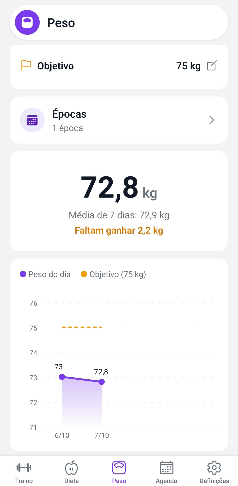

> 💡 Body weight changes a lot from day to day (water, food). Look at the **7-day average** in the summary: it shows the real trend. Weigh yourself at the same time each day, e.g. in the morning.

### 6.1 Phases (bulk, cut…)

Below the goal there is the **Épocas** (phases) button: tap it to open the list of your phases. A phase is a period with a purpose, e.g. "Bulk inverno" or "Cut verão". The button shows the phase going on, if any.

1. Tap **Épocas → + Nova época** (new phase).
2. Type the **Nome** (name) and the **Início** (start) and **Fim** (end) dates as `dd/mm/aaaa` (the slashes are added for you). Don't know when it ends yet? Leave **Fim** empty and set it later.
3. Tap **Criar época** (create phase).

Tap a phase to open it. You see:
- How far along it is (e.g. **Dia 29 de 84**, with a bar) and whether it is **Em curso** (going on).
- The **change** in the phase (e.g. **+1,4 kg**). It starts from your weigh-in on the first day or, if you didn't weigh yourself that day, from your last weigh-in in the 2 weeks before, so a phase you just created already shows where you start.
- The table is there from the start: values not known yet show **—**.
- The **weekly rate**, in kg and as a **% of your body weight** per week (handy to check a bulk or a cut is not too fast or too slow), the number of entries and the lowest and highest weight.
- The **chart** of your weight during the phase.

The ✏️ at the top changes the name or the dates; **Apagar época** (delete phase) removes it. Your weigh-ins are never deleted: a phase only marks dates.

  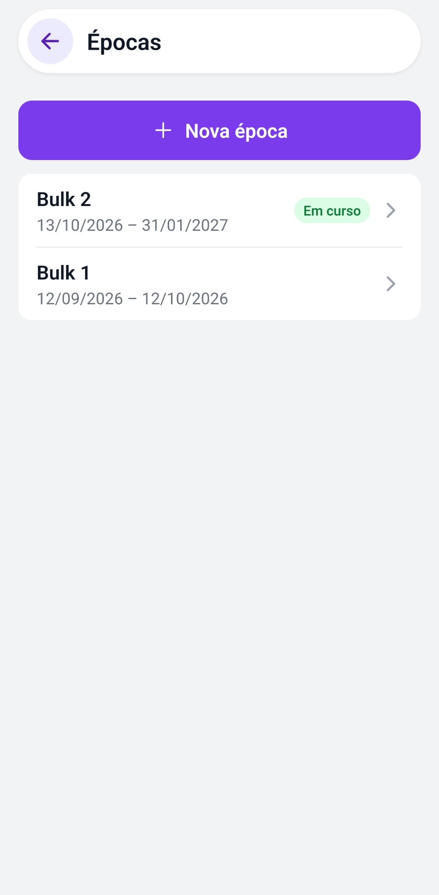
  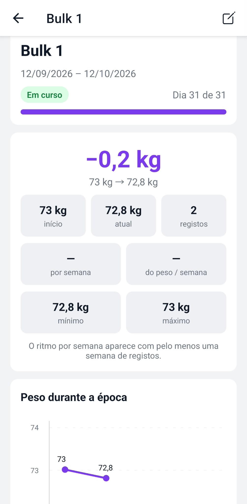

---

## 7. Diet

The app never looks food values up: you create **your own foods** once, and then only type how much you ate.

### 7.1 Goals

The first time, tap **Define os teus objetivos** (set your goals) and type your daily **Calorias** (kcal) and, optionally, **Proteína**, **Carbos** and **Gordura** (protein, carbs, fat in grams). The water goal is set in the water card (see 7.5). Change them later with the ✏️ in the top-right corner of the kcal card.

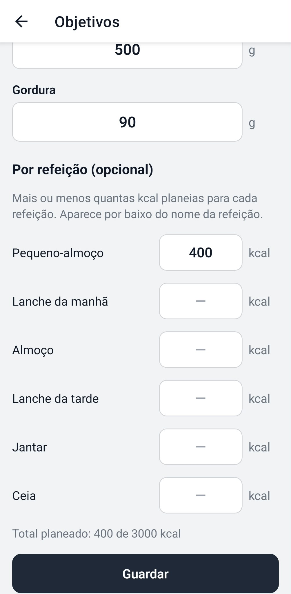

In the same screen, **Por refeição (opcional)** (per meal) lets you type roughly how many kcal you plan for each meal (e.g. Almoço 900). The screen shows the total planned against your daily kcal, and each meal then shows **eaten/planned** (e.g. 420/400 kcal).

At the top of the Diet tab, a big ring fills up with what you ate and shows the **kcal left** in the middle (it turns red when you go over). Below it, a small ring per macro (carbs, protein, fat) shows the grams eaten, with your goal under each one.

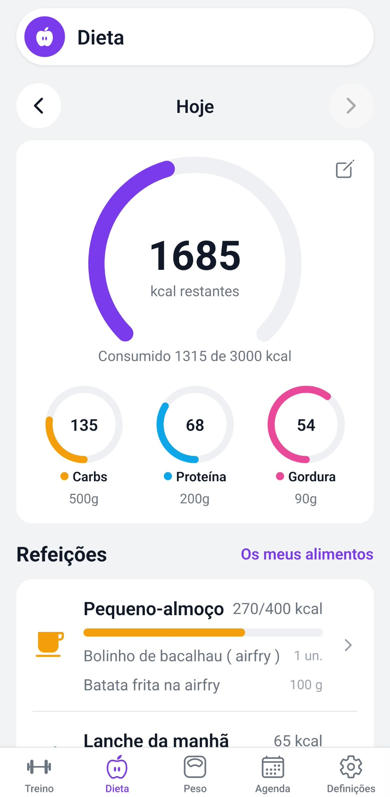

### 7.2 Your foods

**Os meus alimentos** (my foods) → **+**:
1. Type the **Nome** (name), e.g. "Aveia".
2. Choose **Por gramas** (per grams, e.g. per 100 g), **Por ml** (per millilitres, e.g. milk per 100 ml) or **Por unidade** (per unit, e.g. per 1 egg).
3. Type the kcal, protein, carbs and fat for that amount (0 if it has none), as on the label.

Tap a food in the list to **edit** it, or to delete it with **Apagar alimento** (Delete food). Editing a food later does **not** change the days you already logged, and a food you already logged is hidden instead of erased, so old days stay correct.

  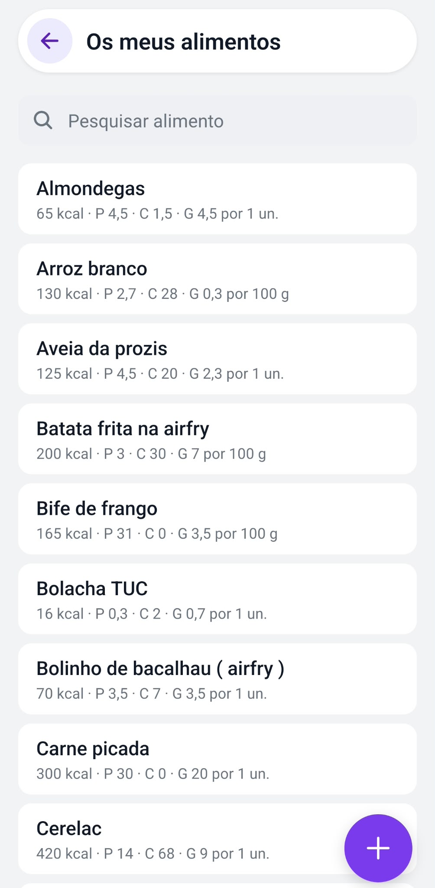
  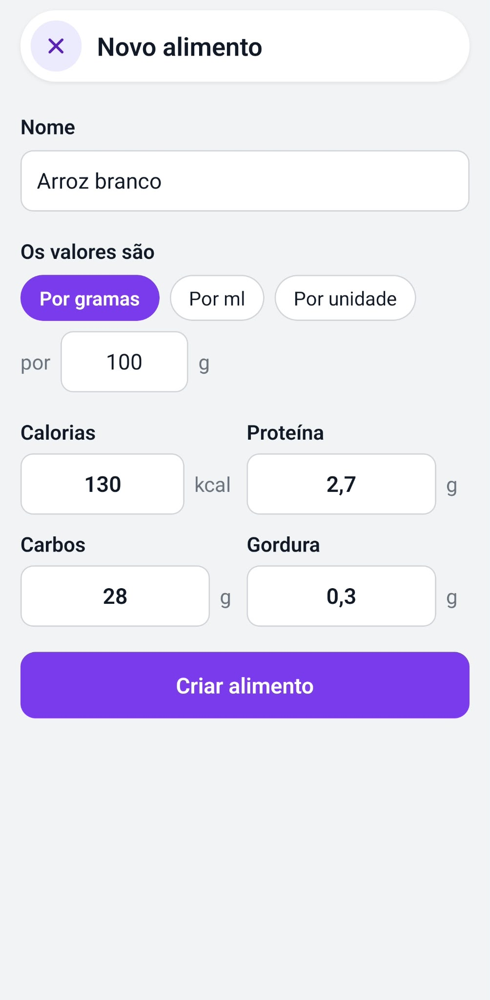

### 7.3 Logging what you eat

Each meal (**Pequeno-almoço**, **Lanche da manhã**, **Almoço**, **Lanche da tarde**, **Jantar**, **Ceia**) has its own icon and colour, the kcal you ate (or **eaten/planned**, e.g. **420/400 kcal**, if you planned it, see 7.1), a bar that fills up and the foods you had, with their amount.

**Tap a meal** to open it. There you see:
- The **kcal left** for that meal (or the kcal eaten, if you didn't plan it).
- Each food, with its amount and kcal. **Tap a food** to change only its amount (its kcal and macros follow, worked out from the values it was logged with); the 🗑 removes it.
- **Informação nutricional** (nutrition facts): a donut with the share of calories from carbs, protein and fat, with the grams of each.

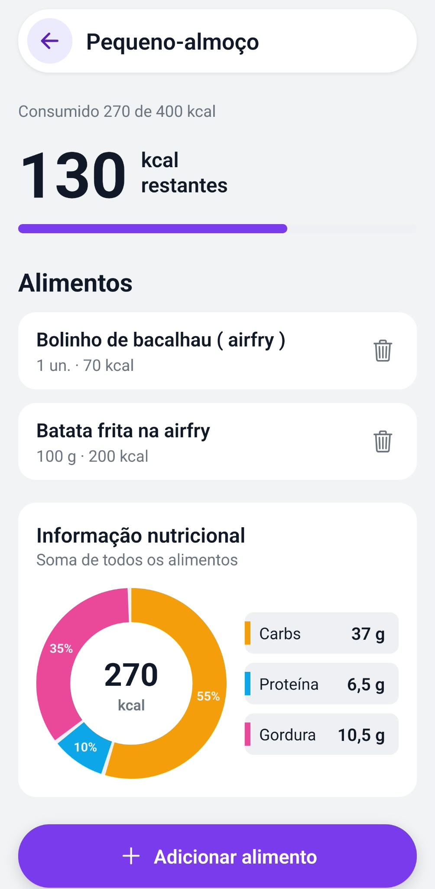

To add a food:
1. Tap **+ Adicionar alimento** (Add food) at the bottom of the meal.
2. Search and pick the food.
3. Type the **grams** (or **ml**, or **units**). The app already suggests the amount of the last time you ate that food (e.g. if you had **2** tostas mistas yesterday, it starts at 2). It shows the kcal and macros for that amount.
4. Tap **Adicionar** (Add).

Can't find the food? Tap **Criar alimento** (Create food) right there.

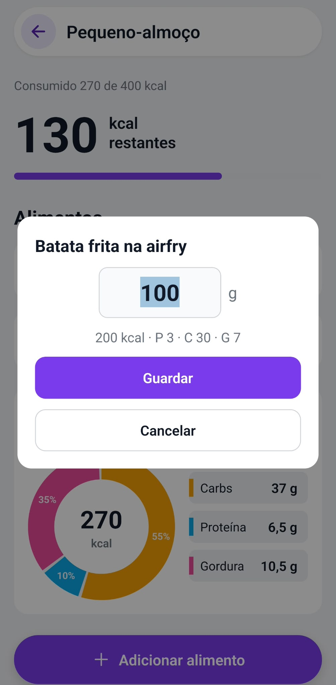

### 7.4 Other days

Use the **‹ ›** arrows at the top to see or log other days (you can't go past today).

> 💡 Create your usual foods once (e.g. per 100 g, as on the label). After that, logging a meal is just picking the food and typing the grams.

### 7.5 Water

At the bottom of the Diet tab, the **Água** (water) card has a bottle that fills up as you drink:
- **+250** and **+500** add a glass or a bottle (in ml).
- **+ Outra** (other) opens a popup to type any amount you drank, in **ml** or **L** (e.g. 330 ml or 1,5 L).
- The **−** takes 250 ml away (e.g. if you tapped by mistake).
- **Tap the total** (e.g. **1,25 L**) to type the exact total of the day.
- **Definir meta** (set goal), at the top right of the card, sets how much you want to drink a day, in ml or L. Tap it again (it then reads e.g. **Meta 2,5 L**) to change it or **Tirar meta** (remove it).

With a goal you see **1,25 L de 2,5 L** and a ✓ when you reach it. Water is saved per day, like the meals: use the **‹ ›** arrows to correct another day.

  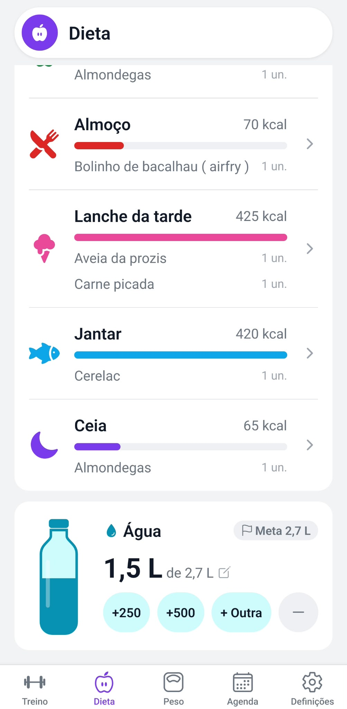
  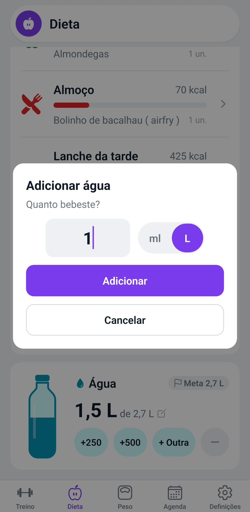

### 7.6 Export body weight and diet to Excel

**Definições → Exportar peso e dieta → Exportar para Excel** (Settings → export body weight and diet) makes an Excel file with your body weight and the kcal, protein, carbs and fat of each day, e.g. to send to the nutritionist or the AI assistant you use for your weekly check.

1. At the top you see from when to when you have data (e.g. *Tens registos de 3 de outubro a 18 de outubro de 2026*).
2. Choose the days: **Tudo** (everything), **Semana passada** (last week, Monday to Sunday), **Últimos 30 dias** (last 30 days) or **Escolher datas** (pick the **De** / from and **Até** / to dates).
3. A summary shows how many days, weigh-ins and days with food that is, and the daily averages.
4. Tap **Exportar Excel**: an .xlsx file is made with one row per day (weight, kcal, protein, carbs, fat and the kcal of each meal, without the foods) and the averages, and the share menu opens to save it to the phone or send it.

Nothing extra is stored: the file is made from your logs each time.

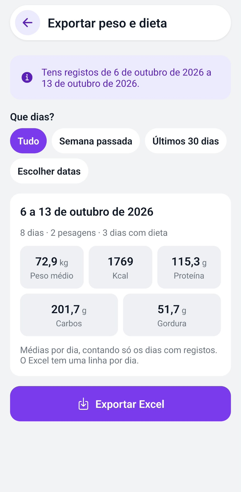

---

## 8. Agenda

The **Agenda** tab has two views, chosen at the top: **Dia a dia** (day to day) and **Agenda**.

### 8.1 Day to day

A to-do list for each day:
1. Type a task in **Nova tarefa** (new task) and tap the round **+** (or the keyboard's Done key).
2. Tap the circle to **tick** it when it's done; tap it again to untick it. The bar at the top shows how many are done (e.g. **2 de 5 feitas**).
3. Tap a task to **rename** it, **Passar para o dia seguinte** (move it to the next day) or **Apagar** (delete) it.

Use the **‹ ›** arrows to go to other days, also future ones (e.g. to plan tomorrow). Tap the day's name to go back to today.

**Tasks that repeat** (e.g. walk the dog on Tuesdays and Thursdays, take the rubbish out every Saturday, read something every day):
1. Type the task in **Nova tarefa** and tap the 🔁 button next to the **+** (or use **Tarefas que se repetem → + Nova tarefa que se repete**, below the list).
2. Choose the days: **Todos os dias** (every day), **Dias úteis** (weekdays), **Fins de semana** (weekends), or tap each day (**Seg … Dom**). Below you read e.g. **Ter e Qui** or **Todos os sábados**.
3. Tap **Criar** (create).

From that day on, the task shows up by itself, at the top of the list, on each of those days, with a small 🔁. You tick it each day like any other task. Tapping it lets you rename it for that day only, **Mudar os dias** (change the days), **Saltar só neste dia** (skip it that day only) or **Deixar de repetir** (stop repeating: it disappears from that day on, and the days before stay as they are). **Tarefas que se repetem** lists all of them, to change or stop them.

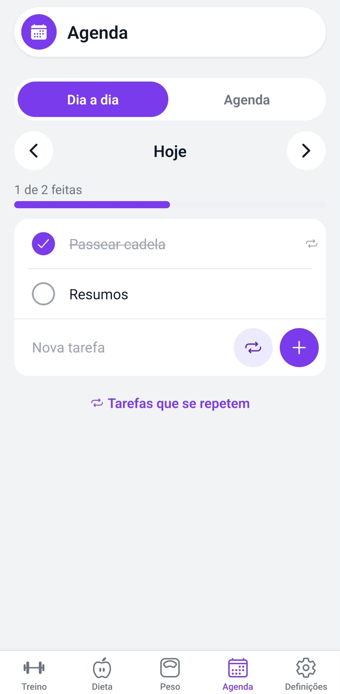

### 8.2 Agenda (events)

For more important things, like appointments:
1. Tap **+ Novo evento** (new event).
2. Type the **Título** (title), e.g. "Dentista", and choose the **Dia** (day) and the **Hora** (time) with the phone's pickers.
3. Choose the **Aviso** (reminder): **Sem aviso** (none), **15 min antes**, **1 hora antes** or **1 dia antes** (15 min, 1 hour or 1 day before).
4. Optionally, add **Notas** (notes), e.g. "levar o cartão de utente".
5. Tap **Guardar evento** (save event).

  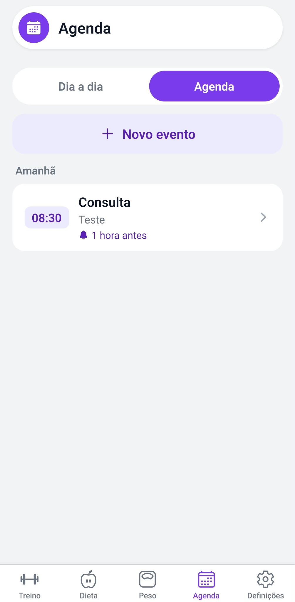
  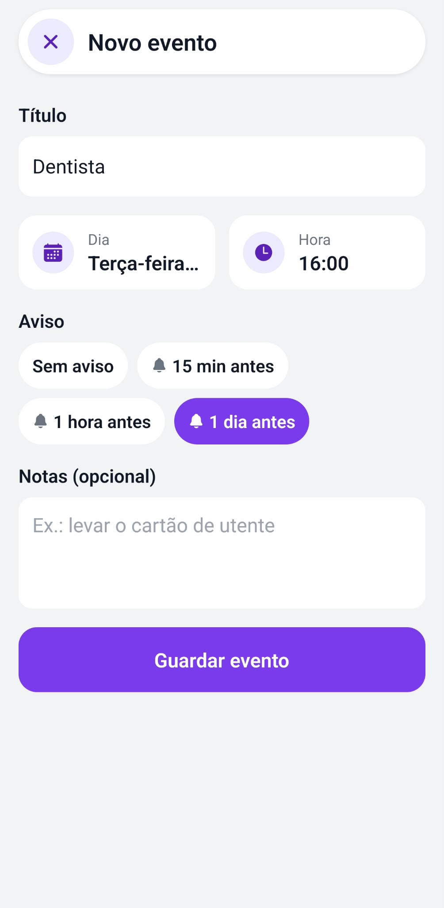

The agenda lists the coming events by day, soonest first, with their time and reminder. Tap an event to change it or **Apagar evento** (delete it). Past events are hidden: **Ver eventos passados** (see past events) shows them.

**Reminders** are notifications made by the phone itself: they go off with the app closed and without internet, also after restarting the phone. The first time you choose a reminder, Android asks for permission to show notifications: allow it. If you said no, turn it on in the phone's settings (Apps → GymLog → Notifications).

### 8.3 Automatic clean-up

So the agenda doesn't keep growing over the years, every time the app opens it deletes:
- tasks **done** more than **30 days** ago;
- tasks **never done** more than **90 days** ago (and tasks that stopped repeating more than 90 days ago);
- events that took place more than **12 months** ago.

Your workouts, body weight and diet are **never** deleted.

---

## 9. Backup: never lose your data

Your data lives **only on your phone**. If you uninstall the app or change phones without a backup, **you lose everything**. Back up regularly (e.g. once a week).

### 9.1 Export

1. **Definições → Exportar backup** (Settings → Export backup).
2. A popup asks what to export: **Treinos** (exercises, routines and workouts), **Peso** (weight), **Dieta** (diet, including water) and **Agenda** (tasks and events). Everything is ticked; untick what you don't want and tap **Exportar**.
3. The share menu opens: choose **Google Drive** (recommended) or send it by email.

The file is called `gymlog-backup-YYYY-MM-DD.json`. For a full backup, keep all the parts ticked.

### 9.2 Import

1. **Definições → Importar backup** (Settings → Import backup).
2. Pick the file. A popup shows the parts it has and what each one holds (e.g. "27 exercícios, 6 rotinas, 20 treinos").
3. Untick what you don't want to import and tap **Importar** (Import).

> ⚠️ Each part you import **replaces** that part in the app (e.g. importing only **Dieta** replaces your foods, meals and water, and leaves your workouts and weight as they are). If something fails halfway, nothing is changed. The light/dark setting is never part of a backup. Phases are part of **Peso**.

A backup made by an **older version** of the app doesn't have what came later (e.g. phases, water or the agenda): importing it leaves those as they are on the phone. After importing the **Agenda**, the reminders of the coming events are set again on this phone.

  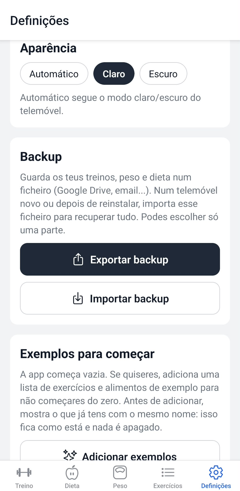
  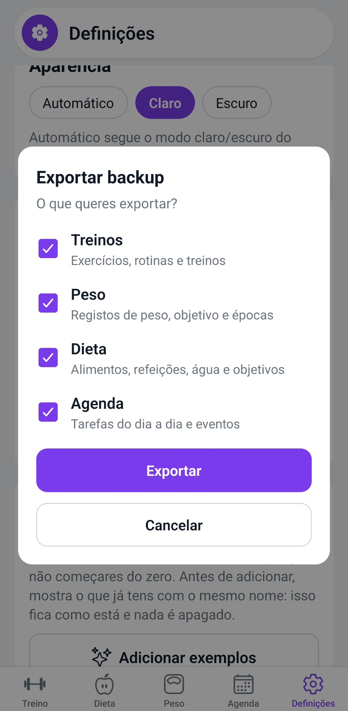

### 9.3 Example exercises and foods

The app starts empty. If you don't want to create everything from zero, **Definições → Exemplos para começar → Adicionar exemplos** (Settings → Examples to get started) adds a list of example exercises and foods. Before adding, a message tells you how many will be added and which ones you **already have** with the same name (accents and capitals ignored): those stay exactly as they are. Nothing of yours is ever deleted or changed, and you can edit or delete the examples like your own.

---

## 10. Light or dark mode

**Definições → Aparência** (Settings → Appearance): **Automático** (follows the phone's light/dark mode), **Claro** (light) or **Escuro** (dark).

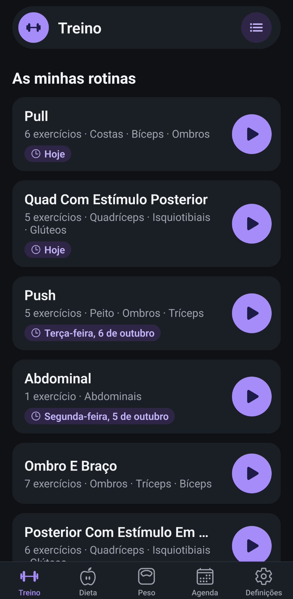

---

## 11. Installing and updating the app

- GymLog is installed from an **APK** file (it is not on the Play Store). When you open the APK, Android asks for permission to install apps from that source: allow it.
- **Updating**: install the new APK **over** the old one. Your data is kept.
- **Don't uninstall** the app without making a backup first.
- **New phone**: export a backup on the old phone, install the APK on the new one and import the backup.

---

## 12. FAQ

**I changed a weight during the workout and the routine didn't change.**
Weights are only copied into the routine when you tap **Terminar** (Finish). If you cancel, nothing changes.

**Do reps with help count as progress?**
No. `100 kg × 6 +1` counts the same as `100 kg × 6`: the +1 is only a reminder.

**Can a friend use the app?**
Yes: send them the APK file (e.g. by WhatsApp or Google Drive). Their data stays on their phone and they start with an empty app; they can add the example exercises and foods (see 9.3) so they don't start from zero.

**I did an extra top set one day. Is it added to the routine?**
Not on its own: a workout only updates the weights and reps. If you want to keep it, tap **Guardar estas séries na rotina** in the summary at the end of the workout (see 4.4), or change the sets in the routine's set editor.

**Why is the 📊 icon of an exercise red?**
That exercise hasn't gone up or down yet. It turns green the first time you change the top set's weight or reps and finish the workout.

**Where did the Exercícios tab go?**
The exercise list now opens from the 📋 button at the top right of the **Treino** tab. Everything in it works the same.

**My reminder didn't go off.**
Check that GymLog may show notifications (Android settings → Apps → GymLog → Notifications) and that battery saving isn't stopping it. A reminder whose time had already passed when you saved the event is not set.

**Some old tasks disappeared.**
That's the automatic clean-up (see 8.3): done tasks are kept 30 days and tasks never done 90 days.

**Can I use the app without internet?**
Yes, everything works offline, reminders included. You only need internet to save the backup to Google Drive or send it by email.

**I deleted an exercise by mistake.**
If you never used it in a workout, it was deleted: create it again. If you had used it, it was archived and your history is kept.
